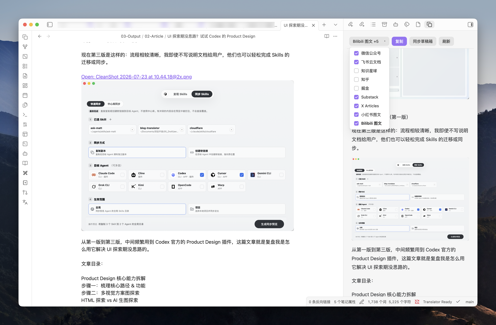
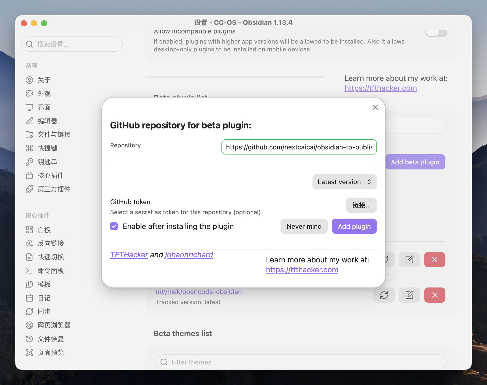
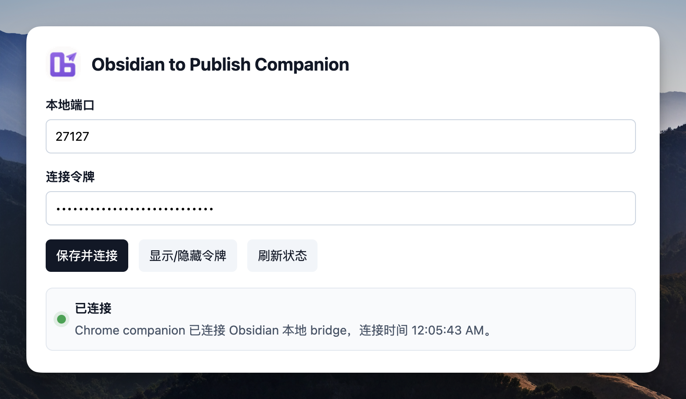

# Obsidian to Publish

打通从 Obsidian 本地创作到多平台发布的最后一步。

这个插件一开始是用来解决我自己多平台发布的痛点。以前在 Obsidian 创作完成后，要同步到其它平台很不方便，尤其是图片上传这活，每个平台都得上传一遍，手动操作一两次后就劝退了。所以我就想着把文档从 Obsidian 上传到多平台这一步直接解决掉。目前这个插件支持 Obsidian 文稿一键上传到微信公众号、飞书文档、知乎、知识星球、X、Substack、bilibili 图文、小红书图文、掘金等平台，后续会增加更多平台支持。



## 核心功能

- 在 Obsidian 右侧栏预览当前笔记，编辑时自动刷新。
- 按目标平台生成适合复制粘贴的内容，包括富文本 HTML、Markdown 和纯文本。
- 支持 Obsidian 笔记一键同步到微信公众号的草稿箱（通过官方 API 实现）。
- 支持 Obsidian 笔记一键同步到指定的飞书文档目录（通过官方 API 实现）。
- 通过配套的 Chrome 浏览器插件，实现 Obsidian 笔记一键同步到常见平台编辑器中、支持笔记图片自动上传。

### 支持平台

| 平台 | 推荐方式 | 内容格式 | 说明 |
| --- | --- | --- | --- |
| 微信公众号 | 官方 API，也可复制 | 富文本 | 推荐配置 AppID / AppSecret 后创建草稿箱草稿 |
| 飞书云文档 | 官方 API，也可复制 | Markdown | 推荐配置飞书自建应用后导入为新版云文档 |
| 知识星球 | 插件复制 / 配套 Chrome 插件 | 富文本 | 适配标题、列表、表格、空行等常见排版 |
| 知乎 | 插件复制 / 配套 Chrome 插件 | 富文本 | 本地图片通常需要手动上传或使用远程图片链接 |
| 掘金 | 插件复制 / 配套 Chrome 插件 | Markdown | 本地图片通常需要先上传为远程图片 |
| Substack | 插件复制 / 配套 Chrome 插件 | 富文本 | 部分图片场景需要手动确认 |
| X Articles | 插件复制 / 配套 Chrome 插件 | Markdown | 面向长文编辑器 |
| 小红书图文 | 插件复制 / 配套 Chrome 插件 | 纯文本 | 适合先生成文字草稿，再在平台内处理图片 |
| Bilibili 图文 | 插件复制 / 配套 Chrome 插件 | 富文本 | 部分图片场景需要手动确认 |

CSDN 的适配代码目前仍在仓库中，但入口暂时隐藏，因为草稿导入稳定性还不够。

## 安装使用

先判断你需要安装什么：

| 使用目标 | 需要安装 |
| --- | --- |
| 只同步到微信公众号草稿箱 | Obsidian 插件 |
| 只同步到飞书云文档 | Obsidian 插件 |
| 只预览并复制内容，手动粘贴到其它平台 | Obsidian 插件 |
| 一键同步到知乎、知识星球、X、Substack、Bilibili、小红书、掘金等平台编辑器 | Obsidian 插件 + 配套 Chrome 插件 |

也就是说：公众号和飞书走官方 API，只需要安装 Obsidian 插件；其它平台如果只复制粘贴，也只需要 Obsidian 插件；如果想让插件自动打开平台编辑器、填入内容、处理图片上传，就需要额外安装 Chrome 插件。

### 方法一：通过 BRAT 插件安装

BRAT（Beta Reviewers Auto-update Tester）是 Obsidian 社区常用的测试版插件安装工具。这个方法适合不想手动复制文件的用户。

1. 在 Obsidian 打开「设置 → 第三方插件 → 社区插件市场」。
2. 搜索并安装 `BRAT`。
3. 启用 `BRAT`。
4. 打开命令面板，运行 `BRAT: Add a beta plugin for testing`。
5. 粘贴本项目仓库地址：

```text
https://github.com/nextcaicai/obsidian-to-publish
```

6. 按 BRAT 提示完成安装。
7. 回到「设置 → 第三方插件」，启用 `Obsidian to Publish`。
8. 如果后续仓库发布新版本，可以通过 BRAT 更新。



### 方法二：把项目发给 Agent 安装

如果你正在使用 Codex、Cursor、Claude Code 或其它本地 Agent，可以把这个项目交给 Agent，让它自动找到插件文件并安装到指定 vault。

你可以直接把下面这段话发给 Agent：

```text
请帮我安装这个 Obsidian 插件项目。

目标 vault 路径是：<填入你的 vault 绝对路径>

请在项目里找到 Obsidian 实际加载需要的文件：
- manifest.json
- main.js
- styles.css

如果 main.js 不存在或不是最新的，请先按项目说明运行构建命令。
然后把这 3 个文件复制到：
<Vault>/.obsidian/plugins/obsidian-to-publish/

注意：
- 不要修改我的笔记内容。
- 不要删除或覆盖其它插件目录。
- 不要读取、输出或提交 data.json、AppSecret、token 等敏感信息。
- 安装完成后告诉我需要在 Obsidian 里启用或重载插件。
```

这个方法的关键是：Agent 不需要理解整个项目，只需要找到 Obsidian 插件实际加载的 3 个文件，并把它们放到正确目录。

### 方法三：从 Releases 下载文件安装

如果你不想安装 BRAT，也不想让 Agent 操作，可以直接从 GitHub Releases 下载已经构建好的插件文件。

1. 打开项目的 [Releases 页面](https://github.com/nextcaicai/obsidian-to-publish/releases)。
2. 选择最新版本。
3. 下载发布附件里的插件文件。如果有压缩包，先解压；如果是单独文件，请下载下面 3 个文件：
   - `manifest.json`
   - `main.js`
   - `styles.css`
4. 在你的 vault 里创建插件目录：

```text
<Vault>/.obsidian/plugins/obsidian-to-publish/
```

5. 把下载到的 3 个文件放进去，最终目录应该是：

```text
<Vault>/.obsidian/plugins/obsidian-to-publish/
  manifest.json
  main.js
  styles.css
```

6. 回到 Obsidian，打开「设置 → 第三方插件」，启用 `Obsidian to Publish`。
7. 如果已经打开过 Obsidian，建议重载插件或重启 Obsidian。

> [!WARNING]
> 不建议在主力 vault 里开发或测试插件。请先用单独的测试 vault 验证，避免插件 bug 影响真实笔记。


### 安装配套 Chrome 插件

如果你只用微信公众号或飞书云文档，不需要安装 Chrome 插件。

如果你想一键同步到其它平台编辑器，例如知乎、知识星球、X、Substack、Bilibili、小红书、掘金，就需要安装配套的 Chrome 插件。原因是这些平台通常没有开放适合个人直接写入草稿箱的官方 API，插件需要借助你本机已登录的 Chrome 页面完成填入和图片上传。

安装步骤（推荐：从 GitHub Release 安装）：

1. 先确认 `Obsidian to Publish` 已经在 Obsidian 里启用。
2. 在 Obsidian 打开「设置 → Obsidian to Publish → Chrome 插件连接」。
3. 打开「启用本地连接」。
4. 复制连接令牌，确认本地端口。
5. 打开本项目最新 [GitHub Release](https://github.com/nextcaicai/obsidian-to-publish/releases)，下载 `obsidian-to-publish-companion-<version>.zip`（版本号与 Obsidian 插件相同）。
6. 解压 zip，得到 `obsidian-to-publish-companion` 目录。
7. 在 Chrome 打开 `chrome://extensions`，打开「开发者模式」。
8. 点击「加载已解压的扩展程序」，选择刚解压出的 `obsidian-to-publish-companion` 目录。
9. 打开扩展选项页，填入端口和连接令牌并保存。Substack 用户可以额外填写自己的后台地址，例如 `https://nextcaicai.substack.com/publish/home`；也可以先打开一次自己的 Substack 后台首页，让扩展自动识别。
10. 回到 Obsidian，打开要发布的笔记，选择目标平台，运行发送到 Chrome 插件的命令。
11. Chrome 插件会打开目标平台编辑器并尝试填入内容；如果自动填入失败，可以用扩展面板里的复制按钮回退。

如果你在改源码或本地开发，也可以直接加载仓库里的 `chrome-companion/` 目录，效果相同。

Chrome 插件的详细说明见 [chrome-companion/README.md](chrome-companion/README.md)。




### 使用微信公众号

微信公众号建议走官方 API。这样做的好处是：正文、图片和封面可以直接进入公众号草稿箱，不需要在编辑器里反复复制粘贴。

1. 打开 [微信开发者平台](https://developers.weixin.qq.com/)。
2. 登录后进入控制台，选中「公众号」进行「基础信息」或类似入口页。
3. 在该页面复制并保存 `AppID`。
4. 在同一页面启用或重置 `AppSecret`，按平台提示完成扫码验证后立即复制保存。
5. 在 Obsidian 打开「设置 → Obsidian to Publish → 微信公众号草稿箱」。
6. 打开「启用微信官方 API」。
7. 填入「微信 AppID」和「微信 AppSecret」。
8. 点击「微信出口 IP → 检测」，复制检测到的 IPv4。
9. 回到微信开发者平台，在该公众号的 API IP 白名单设置中加入这个 IPv4。
10. 可选填写作者、默认摘要、原文链接、留言设置。
11. 打开要发布的笔记，在插件预览面板选择「微信公众号」。
12. 点击创建或同步微信草稿的按钮，成功后到公众号草稿箱检查排版。

如果遇到 `40164`，通常是当前出口 IP 没有加入公众号 API IP 白名单。以插件提示或微信接口返回的 IP 为准，回到微信开发者平台重新加入白名单后再试。


### 使用飞书文档

飞书云文档建议走飞书开放平台 API。这样做的好处是：插件可以把 Markdown 导入为新版云文档，并把本地图片作为文档图片上传。

1. 进入 [飞书开放平台](https://open.feishu.cn/)。
2. 创建一个自建应用。
3. 在应用凭证页获取 `App ID` 和 `App Secret`。
4. 给应用添加文档/云空间相关权限，并按飞书提示发布或启用应用。
5. 在飞书云空间里创建一个目标文件夹。
6. 把这个文件夹共享给包含该应用机器人的群组，并授予编辑权限。
7. 复制目标文件夹 URL，或从 URL 中复制文件夹 token。
8. 在 Obsidian 打开「设置 → Obsidian to Publish → 飞书云文档」。
9. 打开「启用飞书开放平台 API」。
10. 填入「飞书 AppID」「飞书 AppSecret」「目标文件夹 Token 或 URL」。
11. 可选填写「转移所有者 User ID」。
12. 打开要同步的笔记，在插件预览面板选择「飞书云文档」。
13. 点击同步飞书文档的按钮，成功后打开返回的飞书文档链接检查内容。

如果同步失败，优先检查三件事：应用权限是否已生效、目标文件夹是否已共享给应用机器人、文件夹 token 是否填写正确。


### 使用其它平台

其它平台分两种用法：

- 只想生成适合粘贴的内容：只安装 Obsidian 插件即可。
- 想一键打开平台编辑器、自动填入内容、处理图片上传：需要同时安装 Obsidian 插件和配套 Chrome 插件。

这个路径不需要平台官方 API，也不需要把平台账号密码交给插件。

基础复制流程：

1. 在 Obsidian 打开要发布的笔记。
2. 打开右侧 `Obsidian to Publish` 预览面板。
3. 在平台选择器中选择目标平台，例如知识星球、知乎、掘金、小红书或 Bilibili。
4. 检查预览里的标题、列表、表格、代码块、callout 和图片。
5. 点击复制按钮。
6. 打开目标平台编辑器。
7. 粘贴内容。
8. 手动检查图片、空行、表格和代码块，必要时在平台编辑器里微调。

Chrome 插件同步流程：

1. 确认 Obsidian 插件和 Chrome 插件都已安装。
2. 确认 Chrome 里已经登录目标平台账号。
3. 在 Obsidian 打开要同步的笔记。
4. 在插件预览面板选择目标平台。
5. 运行发送到 Chrome 插件的命令。
6. Chrome 插件会打开或定位目标平台编辑器，并尝试填入草稿。
7. 完成后手动检查标题、正文、图片、表格和代码块，再在平台内发布。

<video controls src="docs/assets/readme/platform-zhihu-filled-editor.mp4" title="知乎编辑器填入演示"></video>

## 常见问题

### X Articles 注入时，为什么图片会先堆在文章末尾？

这是 X 编辑器的上传方式导致的临时状态，不代表最终排版。X 会先把新上传的图片块追加到文末；配套 Chrome 插件会等每张图片上传稳定后，再按正文中的图片标记把它们移回原来的位置。

请等 Chrome 插件提示填入完成后，再检查图片位置；执行期间不要刷新页面、切换到其它草稿或手动拖动图片。如果完成后图片仍在文末，或正文中还留有 `[[OTP_IMAGE_...]]` 标记，说明该图片上传或定位失败：可以再次点击「尝试填入」，或在 X 编辑器中手动上传该图片后再发布。

### 飞书云文档也会先把图片堆到文末吗？

不会。飞书走官方 API：插件先导入 Markdown，再逐张在原图片标记的位置创建图片并删除标记；只有这些步骤完成后，才会提示同步成功并返回文档链接。图片较多时同步会更久，但正常情况下打开飞书文档时不会看到图片先集中在文末的中间状态。

如果飞书文档中仍出现图片标记或缺少图片，请查看同步提示中的图片数量与警告。常见原因是原笔记图片资源缺失、格式不受支持，或飞书应用权限/上传请求失败。


## 安全说明

Obsidian to Publish 默认本地处理。预览、复制、本地图片嵌入不会联网。

会联网的场景只有这些：

| 场景 | 网络目标 | 触发条件 |
| --- | --- | --- |
| 微信公众号草稿 | `api.weixin.qq.com` | 你启用微信官方 API 并点击创建/同步草稿 |
| 微信出口 IP 检测 | 微信接口或公网 IPv4 检测服务 | 你在设置里点击「检测」 |
| 飞书文档同步 | `open.feishu.cn` | 你启用飞书开放平台 API 并点击同步 |
| 打开平台编辑器 | 对应平台网站 | 你点击打开编辑器或使用 Chrome companion |
| Chrome companion | `ws://127.0.0.1:<port>/bridge` | 你在桌面端启用本地连接 |

插件不会把笔记、图片、密钥发送到作者服务器，也没有遥测。

### 密钥存储

微信公众号、飞书和 Chrome companion 的配置由 Obsidian 写入当前 vault 的插件数据文件：

```text
<Vault>/.obsidian/plugins/obsidian-to-publish/data.json
```

这个文件可能包含：

- 微信 `appId` / `appSecret`
- 飞书 `appId` / `appSecret`
- 飞书目标文件夹 token、所有者 User ID
- Chrome companion 端口、连接令牌和可选的 Substack 发布地址
- 微信草稿或素材缓存记录

请不要把 `data.json` 提交到公开 Git 仓库，也不要把包含它的 vault 公开分享。如果你的 vault 会通过 iCloud、网盘、Git 等方式同步，这些密钥也会一起同步。

### Chrome companion 权限

Chrome companion 是可选能力，只适合桌面端。它通过本机 WebSocket 接收 Obsidian 发来的发布包，然后在你已登录的平台页面上尝试填入内容。

它不会把发布包发送到扩展作者服务器。为了支持页面加载后的重试和手动回退，Chrome companion 会把最近一次发布包短暂保存在 Chrome 本地扩展存储中，发布包可能包含文章正文、HTML、Markdown 和本地图片数据。缓存默认 30 分钟后过期；你也可以在扩展选项页点击「清空发布缓存」立即清除。Substack 发布地址只会从你打开过的个人 Substack 后台页识别，或由你在扩展选项页手动填写；识别不到时不会打开公共发现页。

真实风险主要来自本机环境：如果连接令牌泄露，本机其它进程可能尝试连接这个本地端口。你可以在插件设置里随时重置令牌。

## 贡献

欢迎提交 issue 或 PR：

- Bug：请说明 Obsidian 版本、插件版本、目标平台、操作步骤、预期结果和实际结果。
- 平台适配：请提供目标平台编辑器链接、粘贴前 Markdown、粘贴后截图，以及哪些元素出错。
- 安全问题：请不要在公开 issue 中贴密钥、token、完整 vault 路径或未脱敏截图。

多平台粘贴回归可以使用 [docs/test-publishing.md](docs/test-publishing.md) 作为测试笔记。

## 联系作者

- 作者：Next蔡蔡
- X：[@aiyacaicai](https://x.com/aiyacaicai)
- 问题反馈：[GitHub Issues](https://github.com/nextcaicai/obsidian-to-publish/issues)

## License

[Apache License 2.0](LICENSE)

Copyright 2026 Next蔡蔡 (nextcaicai)
