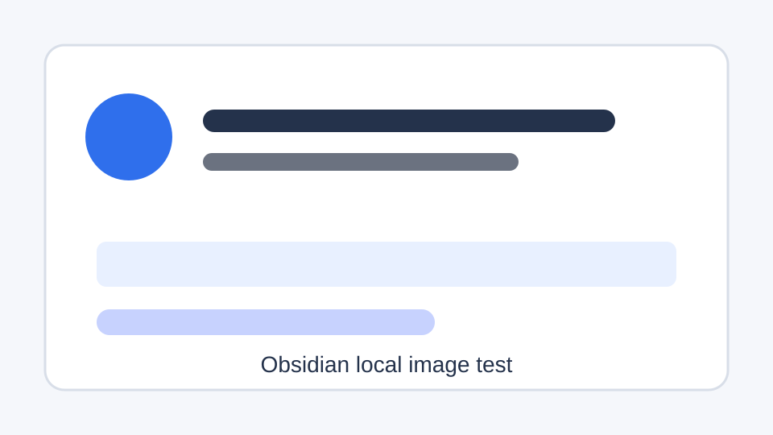

# 多平台粘贴验证基准

这篇笔记用于验证同一份 Obsidian 内容复制到不同平台后的真实表现。每次修改复制、资源包、图片上传或平台 profile 后，优先用这篇笔记做回归。

## 二级标题：基础段落

这是一段普通正文，包含 **加粗文本**、*斜体文本*、`inline code`，以及一个外部链接：[OpenAI](https://openai.com/)。

这是第二段正文，用来观察平台是否保留段落间距和空行。中文标点、英文 words、数字 123，以及长链接 https://example.com/publishing/long-url-check?source=obsidian&target=platform 应该都能正常显示。

### 三级标题：列表

- 无序列表第一项
- 无序列表第二项，包含 [外部链接](https://example.com/)
- 无序列表第三项，包含 `inline code`

1. 有序列表第一项
2. 有序列表第二项
3. 有序列表第三项

- [ ] 未完成任务项
- [x] 已完成任务项

## 引用和 Callout

> 这是普通引用块。验证目标平台是否保留缩进、边框、灰色背景或降级为普通段落。

> [!note] 这是 Obsidian Callout
> 这段内容用于验证 callout 是否保留样式、降级成引用，还是变成普通段落。

> [!warning] 含多段落的 Callout
> 第一段：检查标题和内容是否分离。
>
> 第二段：检查空行是否被保留。

## 表格

| 平台 | 推荐格式 | 本地图片 | 远程图片 | 备注 |
| --- | --- | --- | --- | --- |
| 微信公众号 | Rich HTML | 预期可嵌入或后续 API 上传 | 可显示 | 注意样式清洗 |
| 知乎 | Rich HTML | 需先上传为线上 URL | 预期可显示 | 标题栏和正文 H1 需检查 |
| CSDN | Markdown | 取决于编辑器处理 | 预期可显示 | 代码块和表格优先检查 |
| 掘金 | Markdown / Rich HTML | 需先上传为线上 URL | 预期可显示 | 分类和标签后续处理 |

## 代码块

行内代码示例：`const platform = "zhihu";`

```ts
interface PublishTarget {
	id: string;
	label: string;
	preferredFormat: "rich-html" | "markdown" | "plain-text";
	requiresRemoteImageUrl: boolean;
}

const target: PublishTarget = {
	id: "juejin",
	label: "掘金",
	preferredFormat: "markdown",
	requiresRemoteImageUrl: true,
};
```

```bash
npm test
npm run build
```

## 图片

### 本地图片：Markdown 相对路径



### 本地图片：Obsidian WikiLink

![[assets/local-paste-test.svg]]

### 远程图片：独立 URL


## 链接

- 外部链接：[Example](https://example.com/)
- 裸 URL：https://example.com/plain-url
- Obsidian 内链：[[multi-platform-support-plan]]
- 带别名的 Obsidian 内链：[[multi-platform-support-plan|多平台计划]]

## 分隔线

---

## 验证记录提示

粘贴后重点观察：

- 标题是否被平台当作正文标题，还是需要手动填入平台标题栏。
- 列表、任务列表、表格、代码块是否保留结构。
- 本地图片是否失败，远程 URL 图片是否正常显示。
- Obsidian 内链和 Callout 是否需要降级处理。
- 平台是否清洗了 HTML 样式或 Markdown 语法。
